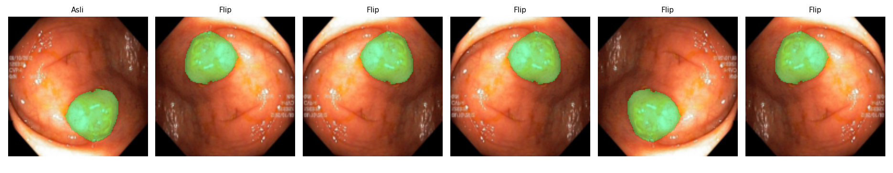
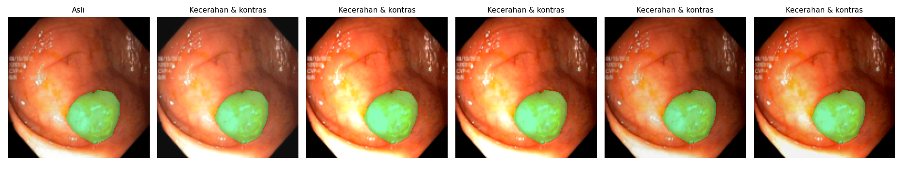
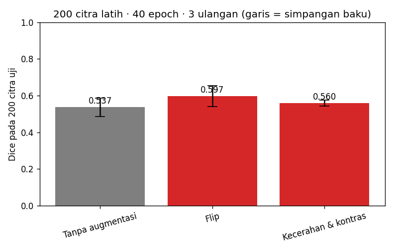
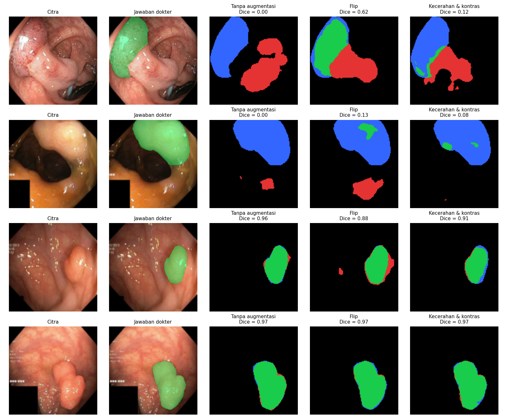

# Segmentasi Polip pada Citra Kolonoskopi dengan U-Net

<!--
  TEMPLATE LAPORAN — Tugas P10 Kecerdasan Buatan (BM25-41204), Teknik Biomedis ITERA.
  Petunjuk lengkap: https://mctm.web.id/ai-bm/tugas

  Cara memakai:
  - Ganti semua teks yang diawali "✍️" dengan tulisan kelompokmu, lalu hapus tanda ✍️-nya.
  - Blok komentar seperti ini adalah petunjuk; tidak tampil di GitHub. Boleh dihapus.
  - Gambar diambil dari folder hasil/ yang dibuat otomatis oleh notebook.
  - Jangan hapus judul-judul bagian (##).
-->

**Tugas P10 — Kecerdasan Buatan (BM25-41204), Teknik Biomedis ITERA**

## Anggota kelompok

| Nama | NIM | Username GitHub | Kontribusi utama |
|---|---|---|---|
| Sely Sabila Permata Hael | 123430050 | Sely20 | Menyusun analisis peta kesalahan, pembahasan dan kesimpulan hasil eksperimen, serta menyunting README.md., menjalankan eksperimen |
| Ulfah Zakiyah Sa'adah | 123430057 | Ulfah-123430057 | Menjalankan eksperimen final model U-Net, mengumpulkan dan mendokumentasikan hasil pengujian augmentasi, memperbarui README.md dan visualisasi hasil pada repository GitHub. |
| Sulthan Rayyanir Rizk | 12343087 | sulthanrayanir | membimbing teman teman |

## 1. Pertanyaan

Augmentasi apa yang membantu U-Net menemukan polip pada citra kolonoskopi, dan augmentasi apa yang tidak? Kenapa?

## 2. Data & pengaturan

<!-- Isi dari Bagian 2 notebook. Pastikan CEPAT = False untuk hasil akhir. -->

- Dataset: Kvasir-SEG (1000 citra kolonoskopi + mask polip), diperkecil ke 128 × 128 piksel.
- Data uji: 200 citra (tetap). Data latih: 200 citra per ulangan.
- Model: U-Net mini (±0,5 juta parameter), 40 epoch, 3 ulangan per skenario.
- Dijalankan di: Google Colab menggunakan GPU.


## 3. Skenario augmentasi & hipotesis

<!-- Tulis bagian ini SEBELUM menjalankan eksperimen final. Commit dulu, baru jalankan.
     Alasan klinis = kenapa variasi ini mungkin (atau tidak mungkin) terjadi pada kolonoskopi sungguhan. -->


| Skenario | Augmentasi (kode) | Alasan klinis | Hipotesis: Dice naik/turun/sama? |
|---|---|---|---|
| Tanpa augmentasi | Tidak menggunakan augmentasi (`None`) | Digunakan sebagai kondisi pembanding untuk mengetahui performa dasar model U-Net. | Menjadi nilai acuan (baseline). |
| Flip | `v2.RandomHorizontalFlip()` dan `v2.RandomVerticalFlip()` | Orientasi tampilan kamera kolonoskopi dapat bervariasi selama pemeriksaan. Kewajaran flip vertikal perlu dievaluasi. | Diperkirakan naik dibanding baseline. |
| Kecerahan & kontras | `v2.ColorJitter(brightness=0.3, contrast=0.3)` | Intensitas pencahayaan dan kontras citra kolonoskopi dapat bervariasi selama pemeriksaan. | Diperkirakan naik dibanding baseline. |

Contoh augmentasi yang dicoba:





<!-- Gambar akan tampil setelah file hasil/ dimasukkan ke repository. -->


## 4. Hasil

<!-- Tempel isi hasil/ringkasan.md di sini. -->

| Skenario | Dice (rata-rata ± sb) | IoU (rata-rata ± sb) | Dice tiap ulangan |
|---|---|---|---|
| Tanpa augmentasi | 0.537 ± 0.049 | 0.427 ± 0.046 | 0.506, 0.607, 0.498 |
| Flip | 0.597 ± 0.056 | 0.496 ± 0.053 | 0.627, 0.646, 0.518 |
| Kecerahan & kontras | 0.560 ± 0.017 | 0.446 ± 0.011 | 0.535, 0.571, 0.573 |



## 5. Analisis peta kesalahan



<!-- Hijau = benar, merah = false positive, biru = false negative.
     Pertanyaan pemandu: Polip seperti apa yang sering terlewat (kecil? datar? warna mirip dinding usus?)
     Apa yang sering dikira polip padahal bukan? Apakah augmentasi memperbaiki kasus sulit? -->

Peta kesalahan digunakan untuk mengamati hasil segmentasi secara visual melalui perbandingan antara prediksi model dan mask referensi (ground truth). Pada visualisasi tersebut, warna hijau menunjukkan area yang berhasil diprediksi dengan benar (true positive), warna merah menunjukkan area yang salah diprediksi sebagai polip (false positive), sedangkan warna biru menunjukkan bagian polip yang tidak berhasil terdeteksi (false negative). Visualisasi dilakukan terhadap empat sampel citra uji yang dipilih berdasarkan nilai Dice pada skenario tanpa augmentasi, yaitu dua citra dengan nilai Dice terendah dan dua citra dengan nilai Dice tertinggi. Pemilihan ini bertujuan untuk mengamati perbedaan pola kesalahan segmentasi pada citra dengan tingkat kesulitan yang berbeda serta membandingkan pengaruh masing-masing skenario augmentasi terhadap hasil prediksi.

Pada dua citra pertama yang memiliki tingkat kesulitan lebih tinggi, model tanpa augmentasi menghasilkan nilai Dice sebesar 0,00 pada kedua sampel. Kondisi tersebut menunjukkan bahwa hasil prediksi model belum memiliki irisan area yang berarti dengan mask referensi. Setelah penerapan augmentasi flip, nilai Dice pada citra pertama meningkat menjadi 0,62. Peningkatan ini terlihat dari bertambahnya area berwarna hijau yang menunjukkan semakin banyak bagian polip yang berhasil dikenali oleh model. Sementara itu, augmentasi kecerahan dan kontras hanya menghasilkan nilai Dice sebesar 0,12. Pada citra kedua, peningkatan yang diperoleh dari kedua jenis augmentasi masih relatif kecil, yaitu 0,13 pada augmentasi flip dan 0,08 pada augmentasi kecerahan dan kontras. Visualisasi memperlihatkan bahwa area berwarna biru dan merah masih cukup dominan, yang menunjukkan bahwa model masih mengalami kesalahan dalam mengenali keseluruhan area polip maupun menentukan batas segmentasinya. Hasil ini memperlihatkan bahwa augmentasi flip dapat membantu memperbaiki segmentasi pada citra sulit tertentu, tetapi belum mampu mengatasi seluruh permasalahan segmentasi pada setiap sampel.

Berbeda dengan kedua citra sebelumnya, dua citra terakhir menunjukkan hasil segmentasi yang relatif baik pada seluruh skenario. Pada citra ketiga, model tanpa augmentasi memperoleh nilai Dice sebesar 0,96, sedangkan augmentasi flip dan kecerahan-kontras masing-masing menghasilkan nilai 0,88 dan 0,91. Penurunan nilai Dice tersebut menunjukkan bahwa penerapan augmentasi tidak selalu meningkatkan hasil segmentasi, terutama pada citra yang sejak awal telah berhasil dikenali dengan baik oleh model. Meskipun demikian, ketiga skenario masih menunjukkan tingkat kesesuaian segmentasi yang relatif tinggi. Pada citra keempat, seluruh skenario menghasilkan nilai Dice yang sama, yaitu 0,97. Kesamaan nilai tersebut menunjukkan bahwa model mampu melakukan segmentasi dengan baik pada citra tersebut tanpa dipengaruhi secara berarti oleh penerapan jenis augmentasi yang berbeda.

Secara keseluruhan, hasil visualisasi menunjukkan bahwa pengaruh augmentasi terhadap segmentasi polip bervariasi bergantung pada karakteristik masing-masing citra. Augmentasi flip memperlihatkan perbaikan yang lebih besar pada salah satu citra dengan tingkat kesulitan tinggi, sedangkan augmentasi kecerahan dan kontras belum menunjukkan peningkatan yang sebanding. Di sisi lain, pada citra yang relatif mudah, penerapan augmentasi tidak selalu menghasilkan nilai Dice yang lebih tinggi dibandingkan model tanpa augmentasi. Temuan ini sejalan dengan hasil evaluasi kuantitatif yang menunjukkan bahwa augmentasi flip memperoleh rata-rata Dice tertinggi sebesar 0,597, diikuti augmentasi kecerahan dan kontras sebesar 0,560, serta tanpa augmentasi sebesar 0,537. Dengan demikian, augmentasi flip memberikan hasil terbaik berdasarkan rata-rata Dice pada eksperimen ini, meskipun peningkatan performanya belum merata pada seluruh citra uji.

## 6. Pembahasan & kesimpulan

<!-- Bandingkan hasil dengan hipotesis di Bagian 3. Hipotesis yang ternyata salah tetap bernilai,
     asalkan dijelaskan kenapa. Perbedaan kecil (lebih kecil dari simpangan baku) belum tentu berarti. -->

Berdasarkan hasil eksperimen, penerapan augmentasi flip dan kecerahan-kontras sama-sama menghasilkan peningkatan rata-rata nilai Dice dibandingkan skenario tanpa augmentasi. Dengan demikian, hipotesis pada kedua skenario augmentasi yang memperkirakan peningkatan performa model didukung oleh hasil eksperimen. Namun, besarnya peningkatan yang diperoleh berbeda pada setiap jenis augmentasi.

Augmentasi flip memperoleh nilai rata-rata Dice tertinggi, yaitu 0,597 ± 0,056, dibandingkan skenario tanpa augmentasi sebesar 0,537 ± 0,049. Hasil ini menunjukkan bahwa variasi orientasi citra melalui transformasi horizontal dan vertikal berpotensi membantu model mempelajari bentuk polip dalam berbagai orientasi. Sementara itu, augmentasi kecerahan dan kontras memperoleh nilai Dice sebesar 0,560 ± 0,017. Peningkatan tersebut menunjukkan bahwa variasi intensitas pencahayaan dan kontras juga dapat memberikan manfaat terhadap proses segmentasi, meskipun peningkatannya lebih kecil dibandingkan augmentasi flip.

Meskipun kedua jenis augmentasi menghasilkan peningkatan rata-rata Dice, hasil tersebut tidak menunjukkan bahwa augmentasi selalu memperbaiki segmentasi pada setiap citra. Berdasarkan analisis peta kesalahan, augmentasi dapat memberikan peningkatan pada citra tertentu, tetapi juga dapat menghasilkan nilai Dice yang lebih rendah pada citra yang sebelumnya telah tersegmentasi dengan baik. Selain itu, nilai simpangan baku pada skenario flip sebesar 0,056 menunjukkan variasi hasil antarulangan yang lebih besar dibandingkan skenario kecerahan dan kontras sebesar 0,017. Oleh karena itu, nilai rata-rata tertinggi tidak serta-merta menunjukkan bahwa hasil augmentasi flip selalu lebih konsisten pada setiap pengulangan.

Secara keseluruhan, augmentasi flip memberikan hasil terbaik berdasarkan rata-rata Dice dan IoU pada konfigurasi eksperimen yang digunakan, diikuti oleh augmentasi kecerahan dan kontras, sedangkan skenario tanpa augmentasi menghasilkan nilai terendah. Namun, kesimpulan ini terbatas pada penggunaan dataset Kvasir-SEG, 200 citra latih per ulangan, ukuran citra 128 x 128 piksel, model U-Net mini, serta tiga kali pengulangan untuk setiap skenario. Dengan demikian, hasil eksperimen menunjukkan bahwa pemilihan jenis augmentasi berpengaruh terhadap hasil segmentasi polip, tetapi efektivitasnya tetap bergantung pada karakteristik citra dan konfigurasi model yang digunakan.

Hasil perbandingan ini belum dapat digunakan untuk menyatakan adanya perbedaan performa yang signifikan secara statistik karena evaluasi hanya dilakukan melalui tiga kali pengulangan tanpa pengujian signifikansi statistik.

## 7. Pembagian kerja

<!-- Siapa mengerjakan apa. Penilaian proses kerja dilihat dari riwayat commit tiap anggota. -->

| Nama | NIM | Username GitHub | Kontribusi utama |
|---|---|---|---|
| Sely Sabila Permata Hael | 123430050 | Sely20 | Menjalankan eksperimen, menyusun analisis peta kesalahan, membahas dan menyimpulkan hasil eksperimen, serta memperbarui dan menyunting README.md. |
| Ulfah Zakiyah Sa'adah | 123430057 | Ulfah-123430057 | Menjalankan eksperimen final model U-Net, mengumpulkan dan mendokumentasikan hasil pengujian augmentasi, serta memperbarui README.md dan visualisasi hasil pada repository GitHub. |
| Sulthan Rayyanir Rizk | 1234.. | ✍️ | ✍️ |

## 8. Penggunaan AI

<!-- Wajib diisi, walau tidak memakai AI (tulis "Tidak memakai AI").
     Contoh: "Claude Code (CLI) untuk menulis skenario augmentasi dan memperbaiki error di Bagian 4.
     Draf Bagian 6 ditulis sendiri, lalu dirapikan bahasanya dengan bantuan AI." -->

ChatGPT (GPT) digunakan sebagai panduan dalam penggunaan Git dan GitHub, serta membantu merapikan bahasa di bagian pembahasan pada README.md. Isi analisis dan interpretasi hasil disusun berdasarkan hasil eksperimen yang diperoleh.

## Cara menjalankan ulang

```bash
uv sync
uv run jupyter lab segmentasi_polip.ipynb
```

Atau buka notebook di Google Colab (Runtime → Change runtime type → T4 GPU).

## Referensi

- Jha, D., dkk. (2020). Kvasir-SEG: A Segmented Polyp Dataset. *MultiMedia Modeling (MMM 2020)*, 451–462.
- Ronneberger, O., Fischer, P., & Brox, T. (2015). U-Net: Convolutional Networks for Biomedical Image Segmentation. *MICCAI*. arXiv:1505.04597.
- Sánchez-Peralta, L. F., Picón, A., Sánchez-Margallo, F. M., & Pagador, J. B. (2020). Unravelling the effect of data augmentation transformations in polyp segmentation. *International Journal of Computer Assisted Radiology and Surgery, 15*, 1975–1988. https://doi.org/10.1007/s11548-020-02262-4
